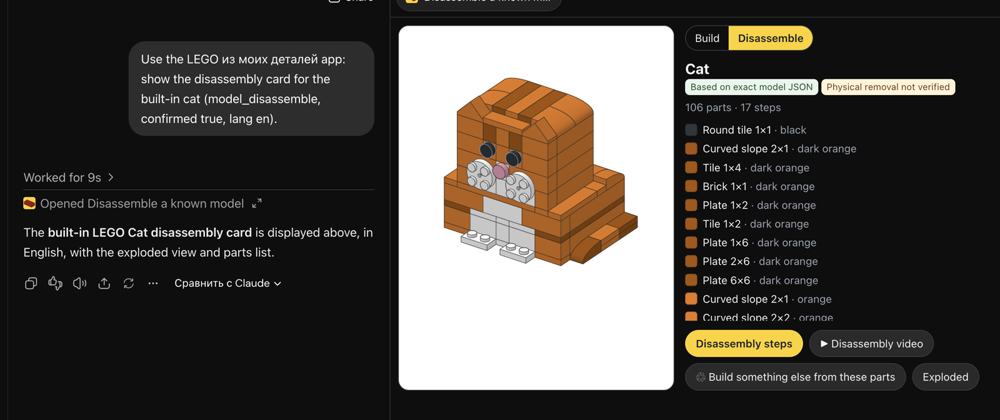

# LEGO from my bricks

[](https://m8ven.ai/mcp/elcodabra-lego-build-inventory-nwdiqy?s=readme)

A Skill plus an MCP server for Claude and ChatGPT. It designs LEGO models **only from the parts you actually own**, checks that the model holds together and that you have enough of every part, and renders step-by-step instructions in the style of an official booklet (PNG, mp4 1080×1920 / 1920×1080).

**Main scenario: photograph your parts → get ideas for what you can build → get the instructions.**

**New (Meta Global AI Developer Hackathon, Nov 2026): photograph a model you already built → take it apart, build something else.** Meta SAM 3.1 outlines the build and Meta Muse Spark 1.3 describes it and suggests which of your saved models it is; you confirm, and the card shows the exact parts list, an exploded view, reverse steps and a disassembly film from the model's real data, then new models from the same bricks (with a BrickLink wanted list for anything missing). The AI only estimates and proposes; exact instructions come only from a confirmed, saved model. Demo script, what is exact vs estimated, limits and what existed before the event (`git tag pre-hackathon`): [docs/meta-hackathon-demo.md](docs/meta-hackathon-demo.md). Code: `lib/meta.cjs`, `lib/analyze.cjs`, `lib/segment.cjs`, `lib/disassembly.cjs`, `lib/shopping.cjs`. *LEGO® is a trademark of the LEGO Group, which does not sponsor, authorize or endorse this project.*

### Try it in 2 minutes (for hackathon judges)

Demo video (1:20): https://youtu.be/NyjUZgB-cw8 · submitted version: git tag `hackathon-submission`.

1. **Connect.** ChatGPT → Settings → Apps → Create app (developer mode), or Claude → Settings → Connectors → Add custom connector. URL `https://lego-mcp.vercel.app/mcp`, auth OAuth. Sign in with a passkey (no password, no e-mail).
2. **Take a built model apart.** Ask: *"Use the LEGO app in English: show me how to take apart the built-in cat model, then what else I can build from its parts."* You get the card with the exact parts list, Build/Disassemble toggle, exploded view, reverse steps, a disassembly film and the rebuild ideas.
3. **Photo of a built model (Meta Muse Spark 1.3 + SAM 3.1).** Upload a photo and ask *"What is this model and how do I take it apart?"* SAM 3.1 outlines the model, Muse Spark describes it and proposes matches from your saved models only; press confirm for the exact data. A build the app does not know gets an honest "no match" and how to add it.
4. **Rebuild.** Press *Rebuild* in the card: new models from the same bricks; ideas that are close come with a BrickLink wanted list.

Cost per photo: about 1 cent of Meta API (Muse ~$0.006 + SAM ~$0.005), capped by a shared daily budget.

**Benchmarks** ([docs/benchmarks.md](docs/benchmarks.md)): with 12 look-alike saved models, Muse Spark 1.3 picks the right one 15/16 (1.2: 14/16, 1.1: 12/16), never invents a model and says "no match" for 3/3 real photos of unknown builds; 100% schema-valid JSON over 112 calls. Card after confirm: 0.44 s p50 on production.

Live in ChatGPT (real UI, Nov 4 2026): the disassembly card for the built-in cat.



```
📷 photo of one part  → Brickognize (part number + colour) ─┐
📷 photo of a pile    → Claude/ChatGPT reads it by eye → CSV ─┼→ inventory → ideas_suggest → idea_build → preview / mp4
sets / CSV / BrickLink                                    ─┘
```

Ideas are parametric models: house, tree, mushroom, rocket, robot, tower, heart, pyramid, fire truck, rover, spaceship, and a spaceport scene (a vehicle plus a ship side by side). The pile-driven ones (spaceship, spaceport) try to use as many of your parts as possible, and ideas are sorted so the one that takes the most parts comes first. Each is built from your parts: it picks the largest size that fits, the colours you have, and the part lengths available. Every proposed model passes the check (no overlaps, nothing floating, all parts in the inventory). Alongside the ideas that build now, it lists the ones that are close, with the exact parts missing. On top of the ideas, the agent can design any custom model from the same parts.

Built on the [siliconbag/lego-build](https://github.com/siliconbag/lego-build) engine (MIT). On top of it this repo adds an inventory, a check against the inventory with substitute suggestions, JSON models, the MCP server, and packaging for Claude Code, claude.ai, Claude Desktop, Codex and ChatGPT.

```
.claude-plugin/marketplace.json        Claude Code marketplace
.agents/plugins/marketplace.json       ChatGPT desktop / Codex marketplace
plugins/lego-inventory-build/
  .claude-plugin/plugin.json           Claude plugin: skill + MCP (stdio)
  plugin.json, mcp.json                portable Agent Plugins manifest (OpenAI)
  skills/lego-inventory-build/         self-contained skill: SKILL.md, engine, CLI, MCP server
scripts/install.sh                     installing and packaging
```

## Which option to pick

| Where | What to connect | How |
|---|---|---|
| **Claude Code** | plugin (skill + MCP) | `scripts/install.sh claude-code` or `/plugin marketplace add <repo>` → `/plugin install lego-inventory-build@lego-tools` |
| **claude.ai** (web/app) | skill zip | `scripts/install.sh zip` → Settings → Capabilities → Skills → Upload. Needs code execution. No network in the sandbox, so rendering is local only |
| **Claude Desktop** | MCP (stdio) | `scripts/install.sh desktop` prints the JSON for `claude_desktop_config.json` |
| **Codex CLI / ChatGPT desktop** | plugin (skill + MCP) | `codex plugin marketplace add <repo>` → `codex plugin add lego-inventory-build@lego-tools` (or `scripts/install.sh codex`) |
| **ChatGPT web** | remote MCP (HTTP) | see below |

On first launch the MCP server runs `npm install` and fetches Chromium for Playwright by itself (about 550 MB on disk, once). You also need **Node 20+** and **ffmpeg** (only for mp4).

### ChatGPT (web, developer mode)

**Quickest: the hosted server** at `https://lego-mcp.vercel.app/mcp`, with sign-in (OAuth 2.1):

1. ChatGPT → Settings → Apps → Create app, URL `https://lego-mcp.vercel.app/mcp`, Authentication: **OAuth**.
2. Claude → Settings → Connectors → Add custom connector, same URL.
3. A sign-in window opens (lego-auth.vercel.app): create an account with a passkey (Face ID, Touch ID or device PIN; no password, no e-mail) and press «Разрешить».

Your parts and models belong to your account, the same in ChatGPT and Claude. Connected apps can be disconnected at https://lego-auth.vercel.app/account. Limits per account per day: 300 tool calls, 10 videos, 40 photos. Pictures and videos are kept for 30 days.

**Or run your own.** ChatGPT only connects to MCP servers over a public HTTPS URL.

```bash
cd plugins/lego-inventory-build/skills/lego-inventory-build
npm run setup
LEGO_MCP_TOKEN=$(openssl rand -hex 16) PUBLIC_URL=https://<your-tunnel> npm run mcp:http   # :8787/mcp
# in another terminal: cloudflared tunnel --url http://localhost:8787   (or ngrok http 8787)
```

1. ChatGPT → Settings → Security and login → **Developer mode**.
2. chatgpt.com/plugins → **+** → URL `https://<tunnel>/mcp?key=<LEGO_MCP_TOKEN>`, auth: No Authentication.
3. In the chat: **+** → Developer mode → LEGO. Prompt: *"Use the lego app. Here are my sets 31058 and 10696, what can I build?"*

The token in `?key=` is simple protection for personal use. For a public service you'd need OAuth and your own hosting (Fly.io, Render, any VPS with Chromium and ffmpeg). Links to mp4/PNG are served from `PUBLIC_URL/files/...`.

### Hosting on Vercel

`api/mcp.mjs` is the serverless entry. Each user's parts and models are one key in Upstash Redis (`api/_store.mjs`: one GET and one compare-and-set per request, daily quotas as atomic counters); without Redis it falls back to a private Vercel Blob store. Rendered PNG/mp4 go to a public Blob store, and identical files are uploaded only once. Handshakes, tool listings and reference tools don't touch storage at all. A full ChatGPT session (import, ideas, build, picture, steps) costs about 4 Blob operations instead of 27, which matters on Vercel Hobby (2,000 per month). Environment:

| Variable | |
|---|---|
| `STATE_BLOB_TOKEN`, `MEDIA_BLOB_TOKEN` | private store for inventories/models, public store for PNG/mp4 |
| `KV_REST_API_URL`, `KV_REST_API_TOKEN` | Upstash Redis (Vercel Marketplace, free plan is enough). Users from the Blob store are copied over on first access |
| `LEGO_MCP_TOKEN` | owner key: no quota |
| `AUTH_ISSUER`, `MCP_RESOURCE`, `AUTH_INTROSPECT_SECRET` | OAuth: the authorization server (`auth/`), this server's canonical resource URL, shared secret for revocation checks |
| `LEGO_OPEN=1` | legacy, without OAuth: anyone can get a personal key at `/` |
| `LEGO_QUOTA_CALLS` / `_VIDEO` / `_PHOTO` | daily limits per open key (300 / 10 / 40) |
| `CRON_SECRET`, `LEGO_MEDIA_DAYS` | daily cron `/api/cleanup` deletes media older than N days (30) |
| `AMPLITUDE_API_KEY` (`AMPLITUDE_ENDPOINT` for the EU region) | usage analytics, see below |
| `YOUTUBE_CLIENT_ID`, `YOUTUBE_CLIENT_SECRET`, `YOUTUBE_REFRESH_TOKEN` | copy build videos to your YouTube channel (see below) |
| `YOUTUBE_PRIVACY`, `YOUTUBE_USERS`, `YOUTUBE_DAILY_MAX` | `unlisted` (or `private` / `public`); whose videos: `owner` (default), a comma list of user ids, or `*`; uploads per day (90) |

**Pile intro.** When the parts list came from a pile photo, build videos of models made from that pile open with ~2.6 s of the pile itself: the photo with the table, floor and shadows removed, every part where it lay, captioned "Мои детали · Из них: <model>". The picture (a ~80 KB JPEG) lives in the user's state as `pile.json`, follows the list through `inventory_undo` and is dropped by `inventory_clear`; a model that uses parts not on that photo gets no intro. Test: `node test/pile-intro.mjs` (real segmentation of a fixture photo).

**Soundtrack.** Build videos carry music synthesized from code (`lib/sound.cjs`): a soft marimba loop paced by the steps, a wooden click each time a part lands, a chime when the model is complete, fade out. No samples or third-party tracks, so there is nothing for YouTube Content ID to claim; key and pattern follow the model title and the same film always gets the same audio. `LEGO_SOUND=0` renders silent films. Test: `node test/sound.mjs`.

**Page colour.** Films are drawn on a light neutral page that changes from model to model (white, warm paper, pale blue, pale sage, pale rose, light grey; picked from the title, so a model always gets the same one). The pile cut-out blends into it and the chat card around the video takes the same colour. Test: `node test/background.mjs`.

**For kids.** The build videos are made mainly for children: follow the steps with your own bricks. They go to the channel *Lego from My Bricks* marked "made for kids" (`selfDeclaredMadeForKids`), which on YouTube means no personalised ads and no comments.

**YouTube.** Every new build video is also uploaded to your channel after the reply (the card never waits for it). The same film goes up only once, and the next time the card has an "На YouTube" button. Setup, once: in Google Cloud create a project, enable *YouTube Data API v3*, set up the OAuth consent screen (External, publish it so the token doesn't expire in 7 days), create an OAuth client of type *Desktop app*, then run `node scripts/youtube-auth.mjs <client_id> <client_secret>` and add the three printed values to Vercel. Limits: an upload costs 1,600 of the default 10,000 API units per day, so about 6 videos a day unless you ask Google for more (the hosted server runs with `YOUTUBE_USERS=*`, every user's films go to the channel, and `YOUTUBE_DAILY_MAX=6`). Until the API project passes Google's audit, YouTube locks uploaded videos as private. Test: `node test/youtube.mjs` and `node test/youtube-users.mjs` (mock Google API).

**Analytics** (Amplitude, rules for adding more in `AGENTS.md`). With `AMPLITUDE_API_KEY` set, both servers send events after the reply:
- MCP server (`platform: mcp`): `session_start`, `user_created`, `tool_call` with tool name, client (chatgpt, claude, codex…), duration, status (429 = daily limit), argument names and a few counts (idea, parts, steps), `video_published` (target youtube, format, steps, parts, pile_intro); `show_build` video calls carry `pile_intro` too. `model_disassemble` adds `disassembly_opened` (model, mode, parts, steps, ms), `exploded_view_rendered` (model, parts) and `model_match_confirmed` (model) when the user picked it after a photo; `model_analyze_photo` sends `photo_model_analyzed` (provider model, provider ms, candidates, top match, confidence), `photo_segmented` (sam-3.1, bricks boxed, outlined) or `meta_request_failed` (error code); the rebuild loop sends `rebuild_ideas_shown` / `rebuild_model_built` (from_model, idea). The photo, the hint and the AI's text are never sent.
- Sign-in server (`platform: auth`): `client_registered`, `authorize_started` / `authorize_error`, `signup`, `login`, `signup_failed` / `login_failed`, `app_connected` / `app_reconnected`, `consent_denied`, `token_issued`, `token_refreshed`, `token_error`, `app_disconnected`, `passkey_added`, `logout`.

A signed-in user has the same anonymous id in both (`"a"` + 24 hex of sha256 of the account id), so the funnel sign-up → connect → tool calls is one person; the owner key is `owner`. Never sent: tokens, codes, keys, account ids, names, e-mails, IPs, photos, part lists, model JSON, media URLs.

### Sign-in server (`auth/`)

Our own OAuth 2.1 authorization server in Next.js, deployed separately (https://lego-auth.vercel.app). It implements what the [MCP authorization spec](https://modelcontextprotocol.io/specification/2025-11-25/basic/authorization) and the ChatGPT Apps SDK require:

- discovery: `/.well-known/oauth-authorization-server` (+ `openid-configuration`); the MCP server publishes `/.well-known/oauth-protected-resource/mcp` and answers 401 with `WWW-Authenticate: Bearer resource_metadata=…`;
- clients: Client ID Metadata Documents (ChatGPT's `https://chatgpt.com/oauth/client.json`, Claude Code) fetched with SSRF protection, and dynamic client registration with exact allowed redirects;
- authorization code + PKCE S256 only, `resource` → token `aud`, `iss` on every authorization response (RFC 9207), refresh tokens rotated with replay detection and a short retry window, code reuse revokes the connection;
- users sign in with passkeys (WebAuthn); access tokens are ES256 JWTs verified by the MCP server against `/jwks.json`; revocation from the account page reaches the MCP server within 15 s (`/introspect`).

Environment: `AUTH_ISSUER`, `AUTH_RESOURCES`, `AUTH_SIGNING_KEY` (private ES256 JWK), `AUTH_SECRET`, `AUTH_INTROSPECT_SECRET`, `KV_REST_API_URL/TOKEN`. Test: `cd auth && npx next build && node test/e2e.mjs` runs the whole chain (auth server, MCP server, the MCP SDK OAuth client, a real browser with a virtual passkey) plus negative cases: 42 checks.

## MCP tools

| Tool | What it does |
|---|---|
| `parts_from_photo` | photos of single parts → part number and colour (Brickognize), `add=true` adds them to the inventory. In ChatGPT it accepts uploaded files (`openai/fileParams`) |
| `parts_from_pile_photo` | a photo of a whole pile → every part found and recognised. The result replaces the saved list by default (`mode: "add"` adds, `"none"` only reports); the previous list is kept, `inventory_undo` brings it back. A cleaned picture of the pile (table removed, parts where they lay) is kept with the list and opens the build videos of models made from it |
| `lego_photo_guide` | how to read a pile of parts from a photo by eye and write a CSV |
| `ideas_suggest` / `idea_build` | what can be built from the inventory right now and what is close; generate the chosen idea. Every idea that is close gets a BrickLink wanted-list XML of the missing parts (Upload → Wanted List on bricklink.com). With `from_model` both use the exact parts of a saved/built-in model instead (the "rebuild" loop after a disassembly: cat → spaceship from the same bricks); the inventory is not touched |
| `inventory_show` / `inventory_import` / `inventory_add_set` / `inventory_update` / `inventory_undo` / `inventory_clear` | parts inventory: CSV, Rebrickable CSV, BrickLink XML, JSON, set numbers (needs `REBRICKABLE_API_KEY`) |
| `lego_guide`, `lego_catalog` | modelling rules, parts and colours the engine can draw |
| `model_check` | overlaps, floating parts, parts missing from the inventory plus spare substitutes |
| `model_bom` | parts list (CSV for a BrickLink wanted list) |
| `model_save` / `model_list` / `model_get` | saved models and the examples (cat, microduck, cottage) |
| `model_preview` | PNG frames straight into the chat (the model can see them and fix things) |
| `model_render` | mp4 of the build |
| `model_disassemble` | how to take a saved or built-in model apart, as a card: exact parts list, exploded view, reverse steps (the build steps backwards, straight from the stored JSON) and, with `mode: "video"`, a disassembly film (the build film played backwards, counted in the daily video quota). `lang: "en"` for an English card. The card switches Build ↔ Disassemble; nothing in the model or the inventory changes. The order is consistent with the model data but not physically tested |
| `model_analyze_photo` | a photo of an already BUILT model → Meta Muse Spark describes what is visible (an estimate, marked "AI estimate") and suggests up to 3 possible matches among the saved and built-in models only; Meta SAM 3.1 outlines the model and boxes the visible bricks on the photo (only what is visible, no hidden geometry). Up to 3 photos (angles of the same model) go to Muse Spark in one request; each counts in the daily photo quota. The user confirms one in the card, then `model_disassemble` draws the exact model. Without a match it says so, asks for other angles and explains how to add a model; if Meta is unavailable the card offers the known models by hand |

**Meta Model API** (`model_analyze_photo`). Server-side only, `lib/meta.cjs` + `lib/analyze.cjs`. The photo is downscaled to 1024 px JPEG and sent to `POST https://api.meta.ai/v1/responses` with a JSON schema whose model-name field is an enum of the user's known models; the answer is validated again with Zod (unknown names rejected, links/paths/control characters stripped). Env: `MODEL_API_KEY` (required), `META_MODELS` (ordered fallback list, default `muse-spark-1.3,muse-spark-1.2`; the next one is used only if the provider says a model is unavailable), `META_EFFORT` (default `low`), `META_MAX_OUTPUT_TOKENS` (4000), `META_BUDGET_USD` (total cap, default 100), `META_DAILY_BUDGET_USD` (default 20). Every call reserves its worst-case price and settles to the real cost from the API's `usage`; the counter is shared across instances in Redis. Contributor-mode models (Meta may train on the request) are allowed only when listed explicitly. Tests: `node test/meta-mock.mjs` (no network), `npm run test:meta-live` (2 real calls, about $0.015), `npm run meta:compare -- --models muse-spark-1.3,muse-spark-1.2 --photos a.jpg:cat,b.jpg:none --max-usd 0.5` (compare models on the same photos: match, latency, tokens, real cost; results in `test/results/`).

Data lives in `~/.lego-build/` (`LEGO_DATA_DIR`) and is shared between the skill CLI and the MCP server.

## CLI (what the skill uses)

```bash
cd plugins/lego-inventory-build/skills/lego-inventory-build
node tools/photo.cjs --add --qty 4 part1.jpg part2.jpg   # photos of single parts → inventory
node tools/ideas.cjs                             # what can be built now and what is close
node tools/ideas.cjs build house                 # → models/house.json (already checked)
node tools/snap.cjs final --model models/house.json
node tools/inventory.cjs add-set 31058          # or: import my.csv / add 3001 red 4
node tools/inventory.cjs show
node tools/model-json.cjs microduck > models/duck.json
node tools/check-model.cjs models/duck.json      # geometry + inventory
node tools/inventory.cjs fit models/duck.json    # what's missing and substitutes
node tools/snap.cjs 3 final --model models/duck.json
node tools/render.cjs --model models/duck.json
npm test                                         # e2e: CLI + MCP stdio + MCP HTTP (add --render for mp4)
```

## Limitations

- **Photos.** Brickognize recognises one part per photo (the most prominent one) and needs network access. A pile is read by the chat model itself (Claude/ChatGPT vision): that works, but the count is approximate and similar parts (1×4 vs 1×6, light vs dark grey) can get mixed up, so the agent shows the list for confirmation. Best results: parts laid out on a plain background, not overlapping, in daylight. HEIC must be converted to JPEG.
- **Ideas.** There are 8 parametric templates. Anything beyond them the agent designs by hand, and the check applies all the same.
- The engine draws 82 parts: bricks, plates, tiles, slopes, round parts, SNOT 87087, brackets, wheels and wheel bricks (4180), Technic bricks, liftarms, connectors and pins, a roll cage, a ladder, a box and a radar dish. Parts made of several pieces (wheels, frames, liftarms) are checked piece by piece, and Technic pins in holes count as connections. Ideas include a fire truck and a moon rover on wheel bricks. Other parts (Duplo, minifigure parts) are kept in the inventory but not used in models. New parts go into `src/lego.js` (see `reference/modeling.md`).
- Palette of 34 colours with BrickLink/Rebrickable id mapping. Import reports the colours it skipped.
- The check is geometric. Strength, clutch power and balance are not checked, so a model "passes the check" but isn't "tested by hand".
- LEGO® is a trademark of the LEGO Group. This project is not affiliated with it.

## Checking a deployed server

```bash
cd plugins/lego-inventory-build/skills/lego-inventory-build
node test/remote.mjs "https://<app>/mcp?key=<key>" --render              # all tools, live
node test/make-test-photos.cjs ~/Desktop/lego-test                        # test photos + answer CSV for the pile
node test/chatgpt-sim.mjs "https://<app>/mcp?key=<key>" <photo URL>...    # photos in ChatGPT's format (files: download_url)
node test/chatgpt-flow.mjs "https://<app>/mcp?key=<key>" pile.csv --render # pile → ideas → build → preview → video
vercel logs --follow --json | grep '"ev"'                                  # which tools ChatGPT calls, time taken, errors
```
